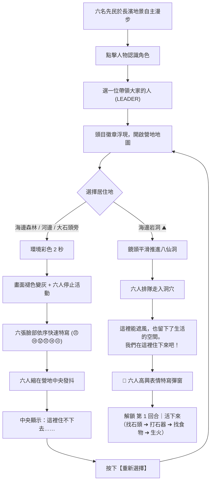

# Prehistoric Culture Game｜長濱文化生活探索

> **開發說明與學術考據手冊**  
> 依據 **國立臺灣史前文化博物館 (National Museum of Prehistory, NMP)** 考古研究與典藏成果深度開發。  
> 核心主題：**八仙洞長濱文化生活重建**、**美式摩登原始人厚紙板剪紙卡牌美術**、**純粹故事導向之六人開局探索**。

---

## 📖 目錄
1. [第一章核心理念與博物館考據](#1-第一章核心理念與博物館考據)
2. [初始先民名冊（6 位先民）](#2-初始先民名冊6-位先民)
3. [第一章雙階段完整遊戲流程](#3-第一章雙階段完整遊戲流程)
4. [部落穩定度、人口繁衍與長老技能傳承系統](#4-部落穩定度人口繁衍與長老技能傳承系統)
   - 4.1 部落穩定度三指標（先穩定 ➔ 後繁衍）
   - 4.2 小孩成長三階段（年齡不是能力，學過才會做）
   - 4.3 長老技能傳承（觀察 ➔ 跟著做 ➔ 學會）
   - 4.4 史前技術斷代危機（知識傳承之死）
5. [美術資產與模組化資料夾規範](#5-美術資產與模組化資料夾規範)
6. [資料架構與小學生閱讀限制（≤15字）](#6-資料架構與小學生閱讀限制15字)
7. [技術實作與檔案清單](#7-技術實作與檔案清單)
8. [快速執行方式](#8-快速執行方式)

---

## 1. 第一章核心理念與博物館考據

### 1.1 歷史中立性與教育意涵（小白建議之落實）
- **非歷史事實反推**：「不住海邊洞穴＝一定死亡」不能當成歷史事實。
- **史前館考古事實**：臺東長濱八仙洞遺址證實，**長濱文化人群確實曾在海蝕洞穴／岩蔭活動，留下了火塘遺跡與大量打製石器**；但考古學並不能反推當時所有人只要在森林或河邊就無法生存。
- **遊戲正解定位**：「海邊洞穴」成為第一關唯一正解的歷史理由，設定為**「我們正在重建八仙洞長濱文化的生活」**，而非生硬宣稱舊石器人只能住洞穴。
- **啟發式學習**：不以長篇課文轟炸學生，而是讓學生在嘗試森林、河邊、巨石中體會潮水、暴雨、無遮蔽的困境，進而深刻理解為什麼八仙洞海蝕洞會留下三萬年前人類生活的深刻痕跡。

---

## 2. 初始先民名冊（6 位先民）

遊戲第一章嚴格由 6 名先民開局，工作定位僅為**能力傾向**，而非考古證明之固定性別分工：

| ID | 角色名稱 | 年齡群組 | 初始定位（能力傾向） | 一句話自我介紹（≤15字） |
| :--- | :--- | :--- | :--- | :--- |
| `elder_m` | **老爺爺** | 老年 (62歲) | 經驗、石器 | 「我認得哪些石頭能做工具。」 |
| `elder_f` | **老奶奶** | 老年 (60歲) | 經驗、採集 | 「先找水、食物和遮風的地方。」 |
| `young_m1`| **青年男A** | 青壯 (24歲) | 狩獵、搬運 | 「我可以去前面探路巡視！」 |
| `young_m2`| **青年男B** | 青壯 (22歲) | 石器、漁獵 | 「海邊有石頭，也能找食物。」 |
| `young_f1`| **青年女A** | 青壯 (23歲) | 採集、探索 | 「我先看看附近有沒有能吃的。」 |
| `young_f2`| **青年女B** | 青壯 (21歲) | 食物、營地 | 「天黑以前，我們要找到休息處。」 |

---

## 3. 第一章雙階段完整遊戲流程



### 3.1 階段一：選一位帶領大家的人
- UI 嚴格規範採用「**選一位帶領大家的人**」，不使用「找出真正的頭目」（長濱文化無固定世襲頭目制度之考古證據）。
- 玩家點選任何一位角色，跳出頭像卡牌與其短語。
- 選定後該角色設定為 `LEADER = selectedCharacter`，頭頂浮現剪紙羽冠徽章 `leader_icon`，並站於隊伍前列代表部族發言。

### 3.2 階段二：選擇居住地
地圖呈現四大探索熱區：
1. 🌳 **海邊森林 (`coast_forest`)**
2. 💧 **河邊 (`river`)**
3. 🪨 **大石頭旁 (`rock`)**
4. ⛰️ **海邊岩洞 (`sea_cave`)【長濱文化正確生活營地】**

玩家點擊時不直接給予正誤提示，而是由帶頭者發言徵詢：
> **「大家今晚住這裡嗎？」**  
> 按鈕：`[住這裡]` ／ `[再看看]`

### 3.3 選錯居住地之失敗動畫歷程
- **非說教式提示**：不寫「你選錯了！史前人不能住森林！」，而是呈現營地失敗情境。
- **動畫節奏**：
  1. 環境彩色維持 2 秒，風雨水流環境音效漸強。
  2. Canvas 漸變褪色變灰 (`filter: grayscale(100%)`)。
  3. 六名角色停滯凍結。
  4. 快速連續彈出六位先民的負面表情特寫卡牌（每張約 480ms）：
     - 老爺爺：😠 生氣
     - 老奶奶：😢 難過
     - 青年男A：😟 擔心
     - 青年男B：😞 沮喪
     - 青年女A：😢 難過
     - 青年女B：😣 生氣
  5. 畫面中央六人緊縮成一團避寒。
  6. 帶頭者發言：「這裡沒有地方遮蔽……」／另一角色：「今晚很難熬。」
  7. 彈出卡牌：「**這裡住不下去……**」，下方附帶史前館考據短語與 `[重新選擇]` 按鈕。

### 3.4 選海邊岩洞之成功歷程
- 鏡頭滑順拉近八仙洞海崖洞穴。
- 六名角色依序走進避風洞窟。
- 文字揭示：「這裡能遮風，也留下了生活的空間。」「我們在這裡住下來吧！」
- 洞穴內點亮溫暖的**火塘營火**（溫暖漸層火光與火焰剪紙跳動）。
- 🎉 六名角色高興特寫卡牌齊聚祝賀！
- 進入**【第 1 回合｜活下來】**：
  - 🪨 尋找礫石（海灘尋找適合敲打之硬石）
  - 🔨 打製石器（打製單面偏峰砍砸器）
  - 🐟 搜尋食物（潮間帶刺魚與採集貝類）
  - 🔥 生火取暖（設立洞內火塘取暖保存火種）

---

## 4. 部落穩定度、人口繁衍與長老技能傳承系統

### 4.1 部落穩定度三指標（先活得穩定，人口才能增加）
遊戲摒棄了突兀的戀愛劇情與冗長對話，以史前生存邏輯驅動部族人口延續：
- **🍗 食物 (Food)**：不能長期缺糧（需維持 ≥ 70%）。
- **⛰️ 住所 (Shelter)**：八仙洞營地必須穩定升火遮風（需維持 ≥ 70%）。
- **🛡️ 安全 (Safety)**：不能連續發生危險或受創（需維持 ≥ 60%）。

**【繁衍歷程】**：
1. 三項指標連續維持 **3 回合** ➔ 系統觸發：**「新的家庭正在形成。」**
2. 兩位青壯年角色頭頂浮現跳動的剪紙愛心圖示（❤️）。
3. 再維持 2 回合 ➔ 系統提示：**「部落多了一個新成員！」** 👶
4. 畫面上誕生新生命【小石】！

---

### 4.2 小孩成長三階段（年齡不是能力，學過才會做）
小孩子絕非一出生就變為勞動人口，需依序經歷三階段生命成長：
1. **👶 幼兒 (Infant, 0~4歲)**：
   - 只能留在營地跟隨大人、玩耍石頭、四處觀察生活。
   - 嚴格禁止從事採集、捕魚或打石器等繁重勞動。
2. **👦 小孩 (Child, 5~12歲)**：
   - 可承擔輕便事務：撿小樹枝、撿小石頭、搬輕物件。
   - **向長老拜師學習技能**。
3. **🏹 少年 (Youth, 13~17歲)**：
   - **學過技能才能上工！**
   - 只有完整向長老學會對應技能，才能執行打製石器、潮間捕魚、採集野果等生產勞動。

---

### 4.3 長老真正用途：三段式技能傳承（觀察 ➔ 跟著做 ➔ 學會）
長老不再只是開場背景，而是文明薪火相傳的支柱！不採用傳統 RPG 數值升級，改用直觀的認知發展進程：

| 長老身分 | 傳授技能 | 傳授台詞（≤15字） | 三段式傳承歷程（觀察 ➔ 跟著做 ➔ 自己完成） |
| :--- | :--- | :--- | :--- |
| 👴 **老爺爺** (`elder_m`) | 🪨 挑選石材<br>🔨 打製石器 | 「跟我來，我教你找石頭。」<br>「手握緊，斜斜敲下去！」 | 1. 觀察長老在海灘敲石<br>2. 跟著長老動手敲打石片<br>3. 自己打出鋒利砍砸刃口 ➔ **學會打石器！** |
| 👵 **老奶奶** (`elder_f`) | 🍒 採集果實<br>🪵 整理柴火 | 「這些能吃，那些不行。」<br>「乾燥的枯枝最好生火。」 | 1. 觀察長老辨認野生植物<br>2. 趣味小分類：🍒 甜野果 [可食] vs 🍄 毒野蕈 [有毒]<br>3. 自己採集無毒野果 ➔ **學會採集！** |

---

### 4.4 史前技術斷代危機（長老離世與知識失傳）
如果長老離開或離世前，某項技能**沒有教給任何孩子**，該項技能就會在聚落中**暫時消失**：
```
👴 長老精通【打製石器】 ➔ 👦 聚落孩子皆未學會 ➔ 👴 長老老死 ➔ ❌ 部落失去「打石器」能力！
```
**【深刻的史前教育意涵】**：
學生將一眼洞察：**「史前時代沒有教科書與文字，知識與文明完全依賴長老一代代口傳身受；一旦傳承中斷，技術就會徹底消失！」**

---

### 4.5 體力值 (Stamina) 與部族名冊任務派遣系統 (Tribe Roster Panel)
點擊頂部橫幅的 **`[👥 部族名冊]`** 按鈕，即可展開族人專屬名冊：
- **體力值動態條 (0~100)**：每位族人擁有獨立體力計量與體能上限。
- **生理特質與年齡經驗分工優勢**：
  - 🌸 **女性先民 (Female Adults)**：撿拾潮間帶魚貝海產、採集野生果實更為精巧細膩，產出收穫顯著高於男性（**收穫 +75%**）。
  - 👴 **長老族人 (Elders)**：畢生經驗老道，採集與打石產出最高（**收穫 +80%**）；但因高齡體能有限，每次勞動耗損 30 體力，工作完成後會自動回營地八仙洞火塘旁烤火休息。
  - 💪 **男性先民 (Male Adults)**：體魄壯碩，於粗重勞力、採集安山硬礫石與打製石器上佔有優勢（**收穫 +50%**）。
  - 👦 **幼童與少年 (Children & Youths)**：負責輕量事務（拾柴、拾石），需跟隨長老學習特定技能後，成年方可承擔獨立生產。
  - 👶 **幼兒 (Infants)**：專屬保護對象，只在營地玩耍觀察，不參與任何勞動。
- **名冊快捷派遣**：可在名冊中直接指派任務：
  - `[🐚 潮間撿拾]`（前往太平洋海岸撿拾魚貝）
  - `[🪨 採集打石]`（前往天然巨石灘敲石採材）
  - `[🪵 撿拾柴火]`（前往海邊森林收集枯枝柴火）
  - `[⛺ 火塘休息]`（返回洞內火塘取暖恢復體力）

---

### 4.6 舊石器時代潮間帶魚貝撿拾（非現代釣魚）
- **歷史考據嚴謹**：舊石器早期長濱文化人類尚未具備現代釣竿與複合金屬釣具。先民採集海產的主要方式是利用退潮時分，在太平洋沿岸的潮間帶礁石區、沙灘淺水坑**撿拾貝類、海螺、牡蠣以及退潮時受困的魚蝦海產**。
- **美式剪紙紙卡動作與方向**：
  - 角色執行潮間帶撿拾時，**全體面向右方太平洋海域 (`facing = 'right'`)**。
  - 呈現節奏平緩、具厚紙板質感的**俯身躬腰撿拾擺動動作**（無劇烈晃動震顫），生動體現先民的生活樣貌。

---

### 4.7 勞動中的意外發現與文化演進系統 (Serendipitous Cultural Inventions)
文明不是憑空出現的，而是在日常勞動中偶然碰撞出火花！
當族人累積完成工作時，會觸發**意外發現事件（💡 燈泡徽章浮現）**，族人興奮說出一句話（≤15字），畫面彈出思維啟發卡牌，要求學生化身先民做出智慧抉擇，收納入文明技巧：

1. **🌿 採集中的意外發現：樹皮的強韌纖維！**
   - **情境短語**：「這樹皮剝下來很韌！」
   - **意外事件**：剝取樹皮時發現撕下來的細長纖維異常堅韌，用力拉扯也不斷裂。
   - **學生抉擇**：
     - ✨【收納入技巧】雙手搓捻成細繩，用於綑綁與編織！➔ **解鎖植物纖維搓繩技巧**
     - 💨 當成普通柴火，直接丟進火塘燒掉 ➔ 提示思考並重新抉擇
   - **史前館考據**：史前先民善用葛藤與苧麻纖維搓捻成繩，這是製作複合工具、捆綁手柄與編織漁網的文明基石。

2. **🪨 採石打器中的意外發現：尖尖的石頭很好用！**
   - **情境短語**：「碎石頭的邊緣好尖銳！」
   - **意外事件**：敲擊硬礫石時，崩落的一塊小薄石片邊緣異常鋒利，手指一碰就能割開獵物皮肉。
   - **學生抉擇**：
     - ✨【收納入技巧】保留鋒利石片，當成割肉刮皮工具！➔ **解鎖單面打製刮削器**
     - 💨 敲碎的小石頭太危險了，踢進海裡 ➔ 提示思考並重新抉擇
   - **史前館考據**：八仙洞遺址出土了大量的單面打製偏峰砍砸器與刮削石片器，正是先民利用碎石尖角處理獵物皮肉的智慧結晶。

3. **🐚 撿拾海產中的意外發現：貝殼與魚骨做成釣具！**
   - **情境短語**：「彎曲的魚骨能勾住肉！」
   - **意外事件**：在潮間帶清理海魚與厚貝殼時，發現彎曲硬骨恰好能倒勾住肉塊，貝殼邊緣也十分鋒利。
   - **學生抉擇**：
     - ✨【收納入技巧】磨出倒鉤並綁上纖維繩，嘗試主動垂釣！➔ **解鎖骨角器與初生釣具**
     - 💨 吃剩的魚骨貝殼沒有用了，隨手丟棄 ➔ 提示思考並重新抉擇
   - **史前館考據**：臺灣史前遺址出土豐富的磨製骨角器與骨魚鉤，標誌著先民從被動潮間帶撿拾走向主動垂釣深水魚類的偉大飛躍。

---

## 5. 美術資產與模組化資料夾規範

所有角色與場景圖資不再混於單一圖檔，依循嚴格的模組化目錄結構定位，皆為獨立生成之去背圖（WebP 與 PNG）：

```
assets/
├── characters/                       # 6 位先民專屬獨立資料夾
│   ├── elder_m/
│   │   ├── body/                     # 身體走動姿態 (透明 WebP / PNG)
│   │   │   ├── idle.webp / idle.png
│   │   │   ├── walk_01.webp / walk_01.png
│   │   │   └── walk_02.webp / walk_02.png
│   │   └── face/                     # 5 種情緒表情圓形剪紙徽章
│   │       ├── normal.webp / normal.png
│   │       ├── happy.webp / happy.png
│   │       ├── angry.webp / angry.png
│   │       ├── sad.webp / sad.png
│   │       └── worried.webp / worried.png
│   ├── elder_f/
│   │   ├── body/
│   │   └── face/
│   ├── young_m1/
│   │   ├── body/
│   │   └── face/
│   ├── young_m2/
│   │   ├── body/
│   │   └── face/
│   ├── young_f1/
│   │   ├── body/
│   │   └── face/
│   └── young_f2/
│       ├── body/
│       └── face/
│
├── locations/                        # 4 大居住地勘查卡牌圖資
│   ├── coast_forest.webp / coast_forest.png
│   ├── river.webp / river.png
│   ├── rock.webp / rock.png
│   └── sea_cave.webp / sea_cave.png
│
├── ui/                               # 介面厚紙板剪紙按鈕與徽章
│   ├── leader_icon.webp / leader_icon.png
│   ├── choice_button.webp / choice_button.png
│   └── game_over.webp / game_over.png
│
└── images/                           # 長濱文化全景地景底圖與工作動作圖
    ├── bg_paleolithic_axis.webp
    ├── action_chopping.webp
    ├── action_fishing.webp
    ├── action_boating.webp
    └── action_weaving.webp
```

---

## 5. 資料架構與小學生閱讀限制（≤15字）

為符合國小學童之閱讀節奏，所有遊戲內對話文本拆分為獨立 JSON，**每句話嚴格控制在 15 字左右**：

```
data/
├── characters.json                   # 6 位先民基礎資料與初始傾向
├── chapter_01.json                    # 第一章階段任務、選項與考據說明
└── dialogue/                         # 6 份獨立角色對話檔
    ├── elder_m.json
    ├── elder_f.json
    ├── young_m1.json
    ├── young_m2.json
    ├── young_f1.json
    └── young_f2.json
```

### 對話檔結構範例 (`data/dialogue/elder_m.json`)：
```json
{
  "id": "elder_m",
  "name": "老爺爺",
  "dialogue": {
    "intro": "我認得哪些石頭能做工具。",
    "leader": "大家跟我來，先找住的地方。",
    "cave": "這個岩洞可以安心休息。",
    "forest_fail": "這裡沒有地方遮蔽風雨。",
    "river_fail": "河流水位離我們太近了。",
    "rock_fail": "這塊石頭擋不住風雨。",
    "round1": "天亮了，先來做石器吧！"
  }
}
```

---

## 6. 技術實作與檔案清單

- **輕量化核心**：原生 HTML5 Canvas + Web Audio API + 模組化 JavaScript（ES6 Class），無肥大遊戲引擎依賴。
- **高傳真音效合成**：`js/core/sound.js` 採用程序化音頻合成海浪、狂風暴雨、木石敲擊與部落排笛。
- **長卷軸鏡頭插值**：`js/core/camera.js` 支援滑鼠、觸控拖曳平移、滾輪左右橫移與 Lerp 平滑追焦。
- **第一章控制器**：`js/core/chapter1.js` 掌理頭目推選、營地驗證、灰階失敗動畫與定居歡慶。
- **厚紙板剪紙渲染**：`js/entities/character.js` 實現紙偶側傾彈跳走動、走動幀切換、表情徽章與頭目羽冠。

---

## 7. 快速執行方式

本專案為靜態前端網頁結構，可直接使用任何靜態伺服器啟動：

```bash
# 進入遊戲專案目錄
cd D:\game\prehistoric-civilization-evolution

# 使用 Python 內建輕量 HTTP 伺服器啟動
python -m http.server 8000
```

瀏覽器開啟：`http://localhost:8000` 即可體驗**【第一章｜找到可以生活的地方】**！
