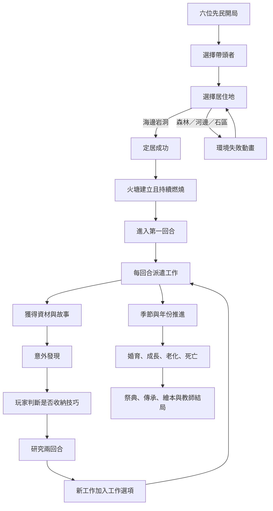

# 史前文明演化：遊戲流程與啟動因果關係

> 本文件整理目前程式實作中的「事件先決條件、觸發點、玩家操作、結果」。
> 用途：教師檢查遊戲因果、學生理解文明發展、後續開發除錯。

主要程式：js/core/game.js、js/core/chapter1.js、js/core/inheritance.js、js/entities/character.js、js/core/discovery.js

---

## 一、整體遊戲主線

---

## 二、第一章開場：定居地選擇

### 2.1 啟動順序

| 順序 | 事件 | 啟動條件 | 結果 |
|---|---|---|---|
| 1 | 生成六位先民 | Chapter1Manager.init() 完成資料載入 | 建立兩位長老、四位青壯 |
| 2 | 選擇帶頭者 | 玩家點擊角色 | 顯示角色介紹卡 |
| 3 | 確認帶頭者 | 玩家在角色卡按確認 | 設定 chapter1.leader |
| 4 | 選擇居住地 | 進入第二階段 | 顯示森林、河邊、石區、海邊岩洞 |
| 5 | 定居成功 | 選擇 sea_cave | 火塘點燃、開始第一回合 |
| 6 | 選錯地點 | 非 sea_cave | 失敗動畫、灰階、角色受寒、重新選擇 |

### 2.2 定居成功的因果

    選擇海邊岩洞
      → 八仙洞成為住所
      → isCampFireLit = true
      → fireLevel = 3
      → 顯示火塘
      → 啟動 ROUND1_SURVIVE
      → startRoundTimeline()
      → 開始派遣工作

火塘一旦建立，正常遊戲中不會真正熄滅；木材只會改變火勢大小與消耗速度。

---

## 三、時間、回合、季節與年份

### 3.1 時間單位

- 一回合 = 一季。
- 一年 = 春、夏、秋、冬四季。
- 一回合時間軸預設 60 秒。
- 遊戲速度可切換 1x、2x、4x。
- 每次回合結束會依序執行結算。

### 3.2 回合結束執行順序

程式入口：game.completeTimedRound()

    時間軸倒數結束
      → applyPerishableSpoilage()
      → inheritance.advanceRound()
          → 冬季時處理小孩成長、成人老化、長老死亡年限
          → 檢查長老告別祭典
          → 計算食物、住所、安全穩定度
          → 檢查婚姻與生育
      → advanceTechnologyProgress()
      → checkFestivalReadiness()
      → 研究冷卻回合 -1
      → roundNumber + 1
      → advanceSeason()
          → 季節往下一季
          → 冬季結束後 yearNumber + 1
      → 更新 HUD
      → 排入角色回報
      → 開始下一回合

### 3.3 石棒紀年

- HUD 顯示目前第幾年。
- 一年完成後新增一根實色石棒。
- 當年度先顯示淡色石棒。
- 四季完成才算完整走過一年。

---

## 四、角色工作派遣因果

### 4.1 玩家操作原則

角色不會因玩家每次點擊而重新開始工作。

    玩家點選角色或名冊
      → 選擇個人／群體
      → 選擇工作指令
      → assignRosterTask()
      → assignStation(force = true)
      → 角色前往工作區
      → 完成工作
      → 回到住所
      → 持續執行原指令

只有玩家重新指定工作，才會中止原工作並變更任務。

### 4.2 基本工作與地點

| 工作 | 地點 | 主要產物 | 可能發現 |
|---|---|---|---|
| 拾柴 | 森林 | 木材、枯枝 | 植物纖維 |
| 採果 | 森林 | 水果 | 食物辨識與保存想法 |
| 撿魚貝 | 海岸潮間帶 | 魚貝 | 魚骨、貝殼、釣具 |
| 採石 | 天然礫石灘 | 石材 | 尖石、刮削器 |
| 河畔搜索 | 森林河邊 | 魚貝 | 黏土 |
| 編漁網 | 居住地 | 漁網耐久 | 需要植物纖維 |
| 做工具 | 火堆旁 | 工具 | 消耗木材、纖維、石材 |
| 燒陶 | 居住地火堆 | 陶器 | 消耗黏土與木材 |
| 維護工具 | 居住地 | 工具耐久恢復 | 消耗木材、石材 |
| 修補漁網 | 居住地 | 漁網耐久恢復 | 消耗植物纖維 |

### 4.3 角色能力差異

| 角色 | 工作規則 |
|---|---|
| 女性成人 | 魚貝與水果採集較精巧，收穫較高 |
| 男性成人 | 採石、工具與粗重工作較有利 |
| 長老 | 經驗高、採集效率高，但體力消耗大，完成後需休息 |
| 小孩 | 可撿小柴、小果、魚貝，也可跟長老學習；工作時間短、需要休息 |
| 幼兒 | 只留在居住地觀察與成長，不執行工作 |
| 少年 | 依學習狀態與技能傳承決定能否獨立工作 |

---

## 五、資材、消耗與火塘

### 5.1 資材分類

| 資材 | 是否消耗 | 用途 |
|---|---|---|
| 魚貝 | 會消耗、會損耗 | 食物、祭典 |
| 水果 | 會消耗、會損耗 | 食物、祭典 |
| 木材 | 火塘與製作會消耗 | 生火、工具、燒陶 |
| 石材 | 工具與維護會消耗 | 石器、工具維修 |
| 植物纖維 | 編網、工具、修網會消耗 | 繩、漁網、綁帶 |
| 黏土 | 燒陶會消耗 | 陶器與食物保存 |
| 玉石 | 稀有、主要作為發現與加工材料 | 裝飾品與文化發展 |

### 5.2 火塘因果

    火塘已建立
      → 每隔一段時間消耗木材
      → 木材足夠：火勢下降一級或維持
      → 木材不足：火勢變弱，但不熄滅
      → 燒陶完成：火塘木材消耗增加

火塘是住所穩定度、祭典、學習、教學、工具維護與燒陶的共同基礎。

### 5.3 食物結算

    回合結束
      → 依存活人口扣除少量魚貝與水果
      → 鮮食依保存狀態產生損耗
      → 燒陶完成後損耗降低
      → 更新食物 HUD
      → 影響部落穩定度與祭典條件

---

## 六、意外發現與技術發展

### 6.1 發現不是立即完成

    角色完成工作
      → 累積該工作次數
      → 達到門檻後進行機率判定
      → 角色頭像晃動、出現發現提示
      → 玩家點擊角色查看故事
      → 玩家選擇正確技術方向
      → 正確：收納線索
      → 錯誤：該角色研究冷卻 3 回合
      → 技術進度累積 2 回合
      → 新工作進入角色工作選項

### 6.2 主要技術鏈

| 發現 | 前置工作／資材 | 研究結果 | 後續工作 |
|---|---|---|---|
| 植物纖維 | 森林拾柴、樹皮 | 搓繩、纖維利用 | 編漁網 |
| 尖石刮削 | 採石、礫石 | 石片工具 | 做工具 |
| 魚骨與貝殼 | 撿魚貝 | 初生釣具 | 釣魚 |
| 植物纖維＋魚骨 | 纖維、魚骨 | 漁獵技術 | 捕大魚 |
| 石材＋木材＋纖維 | 石器與木材 | 粗木加工 | 砍樹 |
| 玉石與打磨 | 玉石、石材、人口 | 裝飾品與加工 | 打磨石材 |
| 河畔黏土 | 河邊搜索、海岸採集 | 燒陶 | 食物保存 |
| 火塘＋完成技術＋傳承 | 火、技術、教學／學習 | 火塘祭典 | 神話傳說 |
| 告別祭典 | 長老死亡年限、食物 | 葬禮與神靈祈禱 | 居住地土堆 |

---

## 七、對談、工作報告與玩家判斷

    回合結束
      → 從有故事、發現或研究線索的角色中選一位
      → 該角色頭像持續晃動
      → 玩家點擊角色牌
      → 顯示工作報告與敘事泡泡
      → 玩家閱讀故事
      → 點擊正確技術方向

底層工作不會因對談視窗停止，對談是最上層資訊層。

### 錯誤研究

    玩家點擊錯誤技術
      → 角色說「我失敗了！」
      → researchCooldownRounds = 3
      → 三回合內不再觸發該角色的新研究線索
      → 玩家等待角色重新整理想法

---

## 八、婚姻、生育與人口因果

### 8.1 婚姻啟動

正常條件：

- 食物、住所、安全三項穩定度達標。
- 連續穩定 3 回合。

人口保護條件：

- 到達第 3 回合仍未形成家庭時，系統會嘗試啟動婚姻配對。
- 只配對無伴侶的成年男女。
- 排除同家庭、親子與共同父母關係，降低亂倫風險。

### 8.2 生育

    玩家確認結為伴侶
      → familyConfirmed = true
      → 累積 8 季
      → 約 2 年後生育
      → 單胎或隨機雙胞胎
      → 家庭關係保留
      → 下一個 8 季週期仍可能再生育

同一家庭可能出現第一個孩子、第二個孩子、第三個孩子，偶爾出現雙胞胎。出生性別會依目前人口比例微調。

---

## 九、成長、老化與死亡

### 9.1 小孩成長

- 小孩經過 3 個完整年份後成為成人。
- 成長期間外觀不變。
- 小孩可以撿小柴、採小果、撿魚貝、跟長老學習。
- 幼兒不執行工作；出生牌卡仍會顯示在角色名冊。

### 9.2 成人變成長老

- 成人累積 10 年後轉為長老。
- 外觀切換為長老紙卡。
- 長老可執行採集、採石、教學與知識傳承。

### 9.3 長老死亡

- 長老累積 10 年後進入待告別狀態。
- 系統每回合檢查糧食是否達標。
- HUD 食物達 80/100，或魚貝＋水果總量達 80% 時，啟動告別準備。
- 族長先說話。
- 玩家確認後進入一回合告別祭典。
- 祭典結束後長老死亡、居住地旁增加土堆，並解鎖神靈祈禱與葬禮文化。

---

## 十、一般火塘祭典

一般祭典與長老告別祭典不同。

### 10.1 自動啟動條件

- 火塘已點燃。
- 糧食達 80/100，或魚貝＋水果達 80%。
- 至少完成兩項技術。
- 曾發生長老教學或小孩學習。
- 沒有正在進行的告別祭典。

### 10.2 流程

    條件達成
      → 族長發言
      → startFestival()
      → 全族回到火塘
      → 圍火跳舞一個完整回合
      → 播放祭典音樂
      → 形成神話傳說
      → 故事加入部族共同記憶

---

## 十一、人口增加後的操作

- 角色名冊固定顯示兩列。
- 超過兩列後由捲軸查看。
- 人口超過 10 人後增加青年男子群、青年女子群。
- 選擇群體後，工作指令會套用至該群成年角色。
- 長老、小孩與幼兒仍以個人卡片管理。
- 點擊個人角色會切回個人派遣模式。

---

## 十二、教師結局與繪本

教師結束遊戲後可查看：

- 目前人口。
- 已收納線索。
- 已完成技術。
- 行為統計。
- 星芒圖。
- 108 課綱學習指標分析。
- 石板風格獎狀。
- 遊戲進程繪本。

繪本應回顧：八仙洞定居、火塘、四個地景資材、角色分工、意外發現、技術發展、知識傳承、婚育老化、祭典與神話。

---

## 十三、核心檢查表

### 開局

- [ ] 先選帶頭者，再選居住地。
- [ ] 只有海邊岩洞能成功定居。
- [ ] 定居後火塘存在且不熄滅。
- [ ] 第一回合時間軸啟動。

### 工作

- [ ] 木材與水果確實在森林。
- [ ] 魚貝在海岸與河畔取得。
- [ ] 角色完成工作後回住處。
- [ ] 玩家可重新派遣正在工作的角色。
- [ ] 工具與漁網會損耗並需要維護。
- [ ] 維護工作能恢復效率。

### 技術

- [ ] 發現是機率事件，不是每次工作必得。
- [ ] 玩家需閱讀故事後選擇技術。
- [ ] 錯誤選擇會浪費三回合。
- [ ] 技術需研究兩回合才完成。
- [ ] 完成後加入工作選項。
- [ ] 技能樹可查看前置資材與地點。

### 人口

- [ ] 第三季前後有婚姻保護機制。
- [ ] 排除親子與同家庭配對。
- [ ] 生育為兩年週期。
- [ ] 支援第二胎、第三胎與雙胞胎。
- [ ] 女孩使用女性幼童紙卡。
- [ ] 新生兒立即出現在名冊。

### 祭典與死亡

- [ ] 一般火塘祭典可自動啟動。
- [ ] 族長會先說話。
- [ ] 一般祭典與告別祭典分開。
- [ ] 長老滿 10 年才進入死亡流程。
- [ ] 糧食達標後不用等到冬季才檢查。
- [ ] 告別祭典持續一回合。
- [ ] 死亡後增加居住地土堆。
- [ ] 解鎖神靈祈禱與葬禮技術。

### 教師結局

- [ ] 有星芒圖。
- [ ] 有 108 課綱學習指標分析。
- [ ] 可列印石板獎狀。
- [ ] 可產出繪本。

---

## 十四、目前應特別留意的實作風險

1. 一般祭典使用 festivalActive，長老告別使用 deathRitual，兩者不可混用。
2. 糧食 HUD 與魚貝／水果實際庫存要能解釋祭典門檻。
3. 年份只能在四季完成後增加。
4. 發現線索不等於技術完成，仍須玩家判斷與研究回合。
5. 動態出生角色必須使用穩定的幼童男／女資材鍵。
6. 人口增加後角色列固定兩列，其餘角色由捲軸與群體選擇處理。
7. 長老離世前若沒有人學會技能，結局分析應呈現技術可能失傳。

---

## 十五、核心程式對照

| 系統 | 主要檔案 |
|---|---|
| 開場、定居、第一回合 | js/core/chapter1.js |
| 回合、資材、祭典、HUD、結局 | js/core/game.js |
| 角色狀態、移動、工作、體力 | js/entities/character.js |
| 婚姻、生育、成長、老化、死亡、傳承 | js/core/inheritance.js |
| 意外發現與研究選擇 | js/core/discovery.js |
| 工作地點 | js/entities/workstation.js |
| 季節災害與環境 | js/entities/disaster.js |
| 技能資料 | data/skills.json |
| 發現資料 | data/discoveries.json |
| 第一章人物與對話 | data/characters.json、data/dialogue/ |
| 介面樣式 | css/ui.css、css/papercraft.css |

